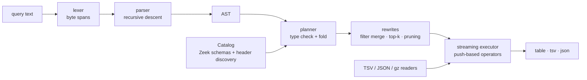

# huntql

A pipe-based threat-hunting query language for Zeek logs, written in Rust.

[](https://github.com/SlateGitOrg/huntql/actions/workflows/ci.yml)

```text
conn | where dport == 443 | stats count() by src | sort -count | head 10
conn | beacon
ssl  | stack ja3
http | rare user_agent by src
dns  | first_seen src, query baseline=6h | stats count() as new_names by src
```

huntql reads Zeek `conn`, `dns`, `http` and `ssl` logs (TSV or JSON, plain or
gzip, rotated files concatenated), type-checks the query against the log
schema with `rustc`-style error messages, plans it (filter merging, `sort |
head` → bounded top-k, column pruning), and runs it on a streaming executor
with documented, enforced memory bounds. Four hunting operators are built
in: `stack` (long-tail frequency), `rare`, `first_seen`, and `beacon`, which
scores connection periodicity from inter-arrival jitter and FFT
autocorrelation.

**Audience:** threat hunters and SOC analysts who have Zeek logs on
disk and want hunting staples (beaconing, long tails, first sightings) as
one-liners without standing up a SIEM; and engineers interested in a small,
complete query-language implementation (lexer → parser → typed AST → planner
→ executor).

> All data in this repository is **synthetic**, produced by huntql's own
> generator, and all evaluation numbers come from generated scenarios. See
> [Limitations](#limitations).

## Quickstart

```bash
cargo build --release            # Rust 1.82+
B=target/release/huntql

$B -d fixtures/demo query 'conn | beacon'
$B -d fixtures/demo run examples/hunt.hql --stats
$B -d fixtures/demo repl         # .help, .schema conn, .explain <q>, .format json
$B -d fixtures/demo explain 'conn | where dport == 443 | stats count() by src | sort -count | head 10'

# your own logs: a directory with conn.log, dns.json, conn.*.log.gz, ...
$B -d /path/to/zeek/logs query 'ssl | stack server_name | head 20' --format json

# synthetic data and the evaluation
$B gen --out /tmp/zeek --seed 3 --hours 24 --hosts 40 --beacons 8
$B eval                          # train seeds 1..=20, held-out seeds 5001..=5050
```

`make check` runs the full gate (rustfmt, clippy `-D warnings`, all tests,
line coverage ≥ 85%). `make demo`, `make eval`, `make bench` reproduce the
outputs below.

## Architecture



| Module | Responsibility |
|---|---|
| `lexer.rs`, `parser.rs`, `ast.rs` | tokens with exact spans; recursive-descent parser; canonical pretty-printer (parse ∘ print is a fixed point, property-tested) |
| `diag.rs` | `Diagnostic` with span, label, help; `rustc`-style rendering; "did you mean" via edit distance |
| `planner.rs`, `expr.rs`, `plan.rs` | name resolution, static types, literal coercion, constant folding, rewrites, `explain` |
| `exec/` | push-based operators with early stop, top-k heap, hash aggregation, hunting operators, group limits |
| `beacon.rs` | periodicity features, radix-2 FFT, autocorrelation candidate search and verification |
| `zeek/` | file catalog, format sniffing, TSV (header directives, escapes) and NDJSON readers, gzip |
| `gen/`, `eval.rs` | deterministic synthetic generator with ground truth; train/held-out evaluation |
| `repl.rs`, `main.rs` | REPL (works in a terminal or a pipe) and CLI |

Deeper design, algorithms and complexity: [docs/ARCHITECTURE.md](docs/ARCHITECTURE.md).

## The language

| Operator | Example | Memory |
|---|---|---|
| `where expr` | `where dport in [80, 8080] and src in 10.20.0.0/16` | O(1) |
| `fields [-] f,..` | `fields ts, src, uri` / `fields - uid` | O(1) |
| `eval n = expr,..` | `eval e = entropy(query), kb = orig_bytes / 1024` | O(1) |
| `rename a as b` | `rename src as client` | — |
| `stats agg,.. [by f,..]` | `stats count(), avg(duration), dc(dst) as peers by src` | O(groups) |
| `sort [-]f,..` / `head n` / `tail n` | `sort -count \| head 10` (fused to top-k) | O(rows) / O(1) / O(n) |
| `dedup f,..` | `dedup server_name` | O(distinct) |
| `stack f,.. [limit=n]` | `stack ja3` | O(groups) |
| `rare f [by e,..] [limit=n]` | `rare user_agent by src` | O(value×entity pairs) |
| `first_seen k,.. [baseline=6h]` | `first_seen src, query baseline=6h` | O(groups) |
| `beacon [by k,..] [min_count=10 min_score=0.5 max_events=20000]` | `beacon by src, dst` | O(groups × events) |

Types: `int`, `float`, `string`, `bool`, `time`, `duration` (`30s`, `1.5m`,
`250ms`, `7d`), `addr` (`10.0.0.1`, `"fe80::1"`), `subnet` (`10.0.0.0/8`).
Operators: `== != < <= > >= =~ !~ in not in and or not + - * / %`.
Functions: `len lower upper contains startswith endswith is_private coalesce
if round abs tostring seconds hour dayofweek bin sld entropy`. Aggregations:
`count sum avg min max dc stdev first last`. Fields: any Zeek column
(`id.orig_h`, `server_name`, …) plus the aliases `src sport dst dport`; extra
columns found in log headers (e.g. `community_id`) are queryable too.

Errors point at the exact source span:

```text
$ huntql query "conn | where duration > 30"
error[plan]: cannot compare duration with int
 --> 1:14
  |
1 | conn | where duration > 30
  |              ^^^^^^^^^^^^^ `duration` vs `int`
  = help: write durations with a unit, e.g. `duration > 30s`
```

More examples (all checked by golden tests) are in [`tests/golden/`](tests/golden).

## Demo

`make demo` runs against the bundled synthetic fixture (`fixtures/demo`: 12 h,
25 hosts, 6 planted beacons; ground truth in `fixtures/demo/truth.json`).
Output pasted from a real run (timings vary):

```text
$ huntql explain "conn | where dport == 443 | stats count() by src | sort -count | head 10"
Scan conn (decode 2 of 21 columns: id.orig_h, id.resp_p)
  -> Filter (id.resp_p == 443)  (streaming, mem O(1))
  -> Aggregate [count()] by [id.orig_h]  (blocking, mem O(groups))
  -> TopK k=10 [-count]  (blocking, mem O(k))
Output [src:addr, count:int]
note: fused sort + head 10 into a bounded top-k heap

$ huntql run examples/hunt.hql --stats
== conn | beacon
src         dst            dport  count  period  jitter  acf     score
----------  -------------  -----  -----  ------  ------  ------  ------
10.20.1.25  203.0.113.202  8443   323    1m54s   0.0263  0.9757  0.9681
10.20.1.18  203.0.113.186  80     118    4m34s   0.1104  0.5665  0.7143
10.20.1.14  203.0.113.32   443    14     48m14s  0.0851  0.6     0.6597
10.20.1.11  203.0.113.209  443    138    4m11s   0.2242  0.26    0.6084
(4 rows)
-- scanned 14785 rows, emitted 4, peak state 15896 rows/groups, 62.8 ms

== ssl | stack ja3
ja3                               count  pct      cum_pct
--------------------------------  -----  -------  -------
72a589da586844d7f0818ce684948eea  607    4.3295   4.3295
b32309a26951912be7dba376398abc3b  3442   24.5506  28.8802
cd08e31494f9531f560d64c695473da9  4065   28.9943  57.8745
773906b0efdefa24a7f2b8eb6985bf37  5906   42.1255  100.0
(4 rows)

== http | rare user_agent by src limit=3
user_agent                                                    count  entities
------------------------------------------------------------  -----  --------
Mozilla/4.0 (compatible; MSIE 7.0; Windows NT 5.1)            118    1
Mozilla/5.0 (Macintosh; Intel Mac OS X 14_3) AppleWebKit/60…  134    6
Mozilla/5.0 (Windows NT 10.0; Win64; x64; rv:123.0) Gecko/2…  153    6
(3 rows)

== dns | first_seen src, query baseline=6h | eval e = entropy(query) | stats count() as new_names, avg(e) as entropy by src | sort -new_names | head 3
src         new_names  entropy
----------  ---------  -------
10.20.1.18  48         3.6896
10.20.1.14  35         3.4194
10.20.1.17  28         3.4031
(3 rows)
```

All four `beacon` alerts are planted beacons. The fixture plants six; the two
not shown at the default threshold are an hourly beacon with 80% jitter
*and* interleaved traffic, and a 15-minute beacon with 50% jitter and one
extra operator connection per period — the hardest conditions in the
evaluation below. `10.20.1.18` (top of the `first_seen` hunt) is the host the
generator made issue 30 random-looking NXDOMAIN lookups; the MSIE user agent
and the rare JA3 are the planted implant fingerprints.

## Beacon detection evaluation

`make eval` (= `huntql eval`): 20 training scenarios (seeds 1–20) choose each
scorer's threshold by maximising F1; metrics are reported on 50 **held-out**
scenarios (seeds 5001–5050) never used during development. Each scenario is
24 h of 40 hosts with 8 planted beacons (period 30 s–1 h, jitter 0–80%,
optional dropped check-ins and interleaved traffic) plus benign browsing,
Poisson pollers and log-normal sync clients chosen as hard negatives. Every
`(src, dst, dport)` channel with ≥ 10 connections is scored.

| scorer | threshold (from train) | precision | recall | F1 | avg precision |
|---|---|---|---|---|---|
| combined (huntql default) | 0.499 | 0.974 | 0.840 | 0.902 | 0.917 |
| interval-only (MAD + skew) | 0.544 | 0.951 | 0.780 | 0.857 | 0.855 |
| ACF-only | 0.487 | 0.767 | 0.600 | 0.673 | 0.660 |

Held-out recall of the combined scorer, by condition and jitter:

| condition | planted | detected | recall |
|---|---|---|---|
| clean | 143 | 143 | 1.00 |
| dropped check-ins | 143 | 142 | 0.99 |
| interleaved noise | 48 | 33 | 0.69 |
| interleaved + dropped | 66 | 18 | 0.27 |

| jitter | 0% | 10% | 20% | 30% | 50% | 80% |
|---|---|---|---|---|---|---|
| recall | 0.82 | 0.88 | 0.86 | 0.92 | 0.82 | 0.73 |

False positives on held-out data: 2 of 1,394 Poisson poller channels, 0 of
606 log-normal sync channels, 7 of 23,257 browsing channels (the full output,
including recall by period, is printed by `make eval`). 63 of the 64 missed
beacons have interleaved traffic on the same channel, so per-jitter recall
mostly reflects how many interleaved cases each jitter bucket received. The
autocorrelation feature is weak on its own (F1 0.673), but the combined
score lifts held-out F1 from 0.857 (interval-only) to 0.902.

## Benchmarks and bounded memory

`make bench` (= `scripts/bench.sh`) generates a small (50 hosts × 24 h) and a
large (200 hosts × 96 h, 15× the rows) conn log and runs six queries with
`/usr/bin/time` for peak RSS.
Apple-silicon Mac (macOS arm64), release build, one core, with other builds
running on the machine at the same time:

| query | data | rows scanned | time (ms) | rows/s | peak state | peak RSS (MiB) |
|---|---|---|---|---|---|---|
| `conn \| where dport == 443 \| head 10` | small | 10 | 0.1 | 100000 | 0 | 3.2 |
| `conn \| where dport == 443 \| head 10` | large | 10 | 0.1 | 100000 | 0 | 3.2 |
| `conn \| where dport == 443 \| stats count() by src \| sort -count \| head 10` | small | 60953 | 25.9 | 2353398 | 50 | 3.2 |
| `conn \| where dport == 443 \| stats count() by src \| sort -count \| head 10` | large | 914010 | 384.4 | 2377758 | 200 | 3.2 |
| `conn \| sort -orig_bytes \| head 10` | small | 60953 | 43.5 | 1401218 | 10 | 3.2 |
| `conn \| sort -orig_bytes \| head 10` | large | 914010 | 644.5 | 1418169 | 10 | 3.2 |
| `conn \| stats count(), avg(duration) by src, dst` | small | 60953 | 31.9 | 1910752 | 1988 | 4.2 |
| `conn \| stats count(), avg(duration) by src, dst` | large | 914010 | 473.2 | 1931551 | 8201 | 6.8 |
| `conn \| beacon` | small | 60953 | 208.4 | 292481 | 64100 | 11.2 |
| `conn \| beacon` | large | 914010 | 3949.5 | 231424 | 929438 | 53.8 |
| `conn \| stats count() by uid` | small | 60953 | 53.3 | 1143583 | 60953 | 27.4 |
| `conn \| stats count() by uid` | large | 914010 | 990.6 | 922683 | 914010 | 268.0 |

Streaming and top-k queries stay at ~3.2 MiB RSS when the input grows 15×
(`head` stops the scan after 10 rows); grouping queries grow with the
number of groups, and a one-group-per-row query (`by uid`) grows with the
input — which is why every blocking operator (`sort`, the fused
`sort | head k` top-k heap, `tail`, `stats`, `dedup` and the hunting
operators) is capped by `--max-groups` (default 2,000,000; exceeding it is a
clean error, so a huge `head k` or `tail n` cannot lift it) and `beacon` stores at
most `max_events` timestamps per channel. "peak state" is the executor's own
count of retained rows/groups (`--stats`). The `stats ... by src` query
decodes 2 of 21 columns (column pruning) and runs at ~2.3 M rows/s; the
top-k query returns whole rows, decodes all 21 columns and runs at ~1.4 M
rows/s.

## Quality gates

| Check | Command | Result |
|---|---|---|
| format + lint + tests + coverage | `make check` | passes from a fresh clone |
| tests | `cargo test` | 99 tests: 70 unit, 11 engine, 8 CLI, 9 property-based, 1 golden suite of 25 queries |
| line coverage | `make coverage` (`cargo llvm-cov --summary-only`) | 95.5% (gate: 85%) |
| size | `make loc` | 7,476 source lines in `src/` (excluding blanks, comments and unit-test modules); 1,028 lines in `tests/*.rs` |

Property tests check: the lexer/parser/planner never panic on arbitrary
input; error spans are always in bounds; `parse(print(ast))` prints
identically; top-k equals stable sort + head; streaming pipelines retain no
rows; aggregation counts sum to the input; time formatting round-trips.
Golden tests pin the output (and rendered errors) of 25 queries. The CI
workflow (`.github/workflows/ci.yml`) runs `make check`, `make demo` and
`make eval` on every push and pull request.

## Design decisions

The full list with trade-offs is in [DECISIONS.md](DECISIONS.md). Highlights:

* **Hand-written lexer and parser** so every token and node has an exact span
  and errors can carry tailored hints.
* **Strict types with literal coercion**: `dst == "fe80::1"` is parsed at plan
  time; `duration > 30` is an error with a fix-it, not a silent unit bug.
* **Push-based executor with early stop**: simple, streaming, and `head`
  short-circuits the scan.
* **Enforced memory caps** instead of spilling: a hunting tool should fail
  fast and clearly on a runaway group-by.
* **Beacon scoring = interval statistics + autocorrelation**: either view
  can carry a beacon. The autocorrelation feature was reworked on training
  seeds after three concrete failure modes (bursts, diurnal rate changes,
  dense channels); the details are in `docs/ARCHITECTURE.md`.
* **Own PRNG and FFT** to keep fixtures byte-identical across platforms and
  the dependency list short.

## Limitations

* **Synthetic evaluation only.** No real traffic was used. The generator
  encodes assumptions about benign traffic (Poisson pollers, log-normal
  sync clients, diurnal bursty browsing) and about implants ("sleep minus up
  to j" jitter, near-constant payloads). Held-out seeds guard against
  overfitting to particular random draws, not against those assumptions.
  Real networks contain benign *periodic* services (NTP, update agents,
  health checks) that were deliberately not generated; they will score high
  and need allow-listing, so real-world precision will be lower than 0.974.
* **Known detection gaps**: beacons mixed with interactive traffic on the
  same channel *and* missing check-ins (27% recall), very high jitter (73%
  at 80%), destinations that rotate (grouping by `src, dst, dport` splits
  them — group on names instead, e.g.
  `ssl | eval d = sld(server_name) | beacon by src, d`), and channels with
  fewer than `min_count` connections in the window.
* **Weights are hand-set**: only the threshold is fitted. The default
  `min_score = 0.5` comes from synthetic training data.
* **Single-threaded**; no indexes; every query scans the files.
* **No spilling**: large `sort` without `head` and very high-cardinality
  `stats` are bounded by `--max-groups` and RAM.
* **Zeek coverage**: built-in schemas for `conn`, `dns`, `http`, `ssl`
  only (other logs work from their headers). Zeek container types (`set`,
  `vector`) are kept as comma-joined strings; there are no container
  operators. IPv6 literals must be quoted.
* **Schema discovery reads the first file only**; rotated files that add
  columns later are not discovered.
* **Terminal output is not sanitised for escape sequences** in log values;
  use `--format json` for untrusted logs if that matters
  (see [docs/THREAT_MODEL.md](docs/THREAT_MODEL.md)).
* The REPL has no line editing or history.

## Roadmap

* Benign-periodicity allow-lists and per-destination popularity (how many
  internal hosts talk to the destination) as beacon context.
* Joins across logs on `uid` (e.g. enrich `beacon` output with SNI/user agent).
* Parallel scans across rotated files.
* Evaluation on public, labelled Zeek captures if one with beacon ground
  truth becomes available.
* `stats` over time windows (`timechart`-style) and percentile aggregations.

## License

MIT — see [LICENSE](LICENSE). Data provenance: [DATA.md](DATA.md).
