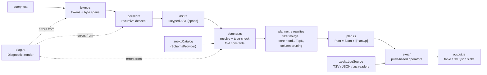

# huntql architecture

This document describes how a query travels from text to results, the key
algorithms (top-k fusion, column pruning, beacon scoring) and the memory
behaviour of every operator.

## Pipeline



| Stage | Module | Output | Failure mode |
|---|---|---|---|
| Lex | `lexer.rs` | `Vec<Token>` with exact byte spans | `Diagnostic` (phase `lex`) |
| Parse | `parser.rs` | `ast::Query` | `Diagnostic` (phase `parse`) |
| Plan | `planner.rs` | `plan::Plan` with typed `expr::TExpr` | `Diagnostic` (phase `plan`) |
| Execute | `exec/` | rows pushed into a `Sink` | `ExecError` (I/O, group limit) |

Every diagnostic carries a `Span` into the original query (or the whole file
for `huntql run`), and `Diagnostic::render` prints a `rustc`-style snippet:

```text
error[plan]: unknown field `dprt`
 --> 1:14
  |
1 | conn | where dprt == 443 | stats count() by src
  |              ^^^^ did you mean `dport`?
```

Suggestions use Levenshtein distance over the names valid *at that point in
the pipeline* (after `stats ... by src` only `src` and the aggregate columns
exist).

## Language

```text
query    = source { "|" stage } ;
stage    = where expr | fields [-] f,.. | eval n = e,.. | rename a as b,..
         | stats agg,.. [by f,..] | sort [-]f,.. | head [n] | tail [n] | dedup f,..
         | stack f,.. opts | rare f [by f,..] opts | first_seen f,.. opts
         | beacon opts [by f,..] opts ;
expr     = or ; precedence: or < and < not < comparison/in/=~ < + - < * / % < unary - ;
literals = 443  0.5  30s 1.5m 250ms 7d  10.0.0.1  10.0.0.0/8  "text"  true false null
```

Field names may be dotted (`id.orig_h`); the 4-tuple aliases `src`, `sport`,
`dst`, `dport` resolve on every Zeek log. The full grammar is in the
`parser.rs` module docs.

### Type system

Zeek types map onto eight query types (`value.rs`): `int` (count/int/port),
`float`, `string` (string/enum/containers), `bool`, `time` (µs since epoch),
`duration` (µs), `addr`, `subnet`. The planner enforces:

* comparisons need equal or both-numeric types; a string literal compared to
  an `addr`/`time`/`subnet` is parsed at plan time (`dst == "fe80::1"`,
  `ts > "2024-03-04T06:00:00Z"`), with a span-accurate error if it is not
  valid;
* `duration > 30` is rejected with a hint to write `30s`;
* arithmetic follows `time - time = duration`, `time ± duration = time`,
  `duration * number = duration`, `/` on numbers always yields `float`;
* `x in [..]` lists must be constants; a list containing subnets becomes a
  CIDR membership test;
* `=~` needs a string literal, compiled once at plan time (invalid regexes
  are plan errors pointing at the literal);
* constant sub-expressions are folded (`1 + 2 * 3` becomes `7`).

Null semantics: arithmetic and functions propagate null; comparisons with
null are false, so `where` drops the row; `count(x)` skips nulls.

## Planner rewrites

1. **Filter merge.** Adjacent `where` stages become one conjunction.
2. **Top-k fusion.** `sort k1, k2 | head n` becomes `TopK`, a max-heap of the
   `n` best rows: O(N log n) time and O(n) memory instead of O(N). Rows carry
   an arrival sequence number as the final tie-breaker so the result is
   identical to a stable sort followed by `head`; a property test
   (`tests/props.rs::topk_equals_sort_then_head`) checks exactly that.
3. **Column pruning.** The planner walks operators until the first
   schema-replacing one (`fields`, `stats`, `stack`, `rare`, `first_seen`,
   `beacon`) and collects every source column referenced. The scan decodes
   only those columns; the others stay `null`. For the canonical query
   `conn | where dport==443 | stats count() by src | sort -count | head 10`
   only 2 of 21 conn columns are parsed.

`explain` prints the resulting plan with each operator's streaming/blocking
nature and memory class.

## Execution model

`exec::execute` is push-based. The source loop pulls one row, then pushes it
through a chain of `Operator`s; each `push` may emit zero or more rows into the
rest of the chain and returns `Flow::Continue` or `Flow::Stop`. `head` returns
`Stop` after its last row, which ends the scan immediately (the head-10 bench
query reads 10 rows of a 914k-row file). Blocking operators emit from
`finish`, which runs in pipeline order so each operator flushes into its
downstream operators.

### Bounded memory

| Operator | Kind | Memory |
|---|---|---|
| `where`, `eval`, `fields`, `rename`, `head` | streaming | O(1) |
| `tail n`, `sort ... \| head n` (TopK) | blocking | O(n) |
| `dedup` | streaming | O(distinct keys) |
| `stats`, `stack`, `first_seen` | blocking | O(groups) (+ distinct values for `dc`) |
| `rare f by e` | blocking | O(distinct (value, entity) pairs) |
| `beacon` | blocking | O(groups × min(events, `max_events`)) |
| `sort` (without `head`) | blocking | O(rows) |

Two mechanisms keep this honest:

* `ExecOptions::max_groups` (CLI `--max-groups`, default 2,000,000) caps the
  rows/groups any single blocking operator may hold; exceeding it is a clean
  `ExecError::GroupLimit`, not an out-of-memory crash.
* `beacon` stores at most `max_events` (default 20,000) timestamps per group;
  further connections still count toward `count` but are not stored.

`ExecStats::peak_state` (printed by `--stats`) samples the total retained
rows/groups every 1,024 input rows and at every `finish`. Property tests
assert it is 0 for streaming pipelines and ≤ n for `tail n` and TopK; the
benchmark (`scripts/bench.sh`) shows peak RSS staying at ~3 MiB for streaming
and top-k queries when the input grows 15× (see README).

Readers are streaming too: `LogSource` concatenates every file of a log
(`conn.log`, rotated `conn.*.log.gz`, `conn.json`) through a 256 KiB buffered
reader, and `TsvReader`/`JsonReader` reuse one line buffer.

## Zeek input

* **TSV**: header directives (`#separator`, `#set_separator`,
  `#empty_field`, `#unset_field`, `#fields`, `#types`) are honoured; `-` is
  null, `(empty)` is the empty string, `\xHH` escapes are decoded. Rows with
  the wrong column count are skipped and counted; unparseable values become
  null and are counted (both reported as a warning).
* **JSON**: one object per line, flat dotted keys, `ts` as epoch seconds or
  ISO-8601; arrays become comma-joined strings.
* **Schema discovery**: the built-in schemas for `conn`, `dns`, `http`, `ssl`
  are extended with any extra columns found in the first file's header (TSV
  `#fields/#types`, or the first JSON object), so fields added by local Zeek
  scripts (`community_id`, `ja3`) are queryable, and unknown log types work
  from their headers alone.
* Format is sniffed from the first byte; `.gz` files are decompressed with
  `flate2`'s multi-member decoder.

## Hunting operators

* **`stack f..`** counts each distinct key and emits the rarest first with
  `pct` and running `cum_pct` — the classic long-tail view (a JA3 seen on 4%
  of TLS sessions next to browsers at 25–42%).
* **`rare f [by e..]`** ranks values of `f` by how many distinct entities
  produced them (then by count): "user agents seen on the fewest hosts".
* **`first_seen k.. [baseline=6h]`** tracks first/last sighting and count per
  key; with a baseline it reports only keys first seen after
  `min(ts) + baseline`, i.e. new in the hunting window.
* **`beacon [by k..] [min_count=10] [min_score=0.5] [max_events=20000]`**
  groups by `src, dst, dport` (by default) and scores periodicity.

## Beacon scoring

Implemented in `beacon.rs`, documented in detail in its module docs. Per
group, with `m` inter-arrival intervals:

| Feature | Definition | Why |
|---|---|---|
| `s_jit` | `(1 - min(1, (MAD/median)/0.7)) · m/(m+4)` | MAD/median ≈ 0.69 for Poisson, `(j/4)/(1-j/2)` for sleep-minus-up-to-j jitter |
| `s_skew` | `(1 - |Bowley skew|) · m/(m+4)` | uniform jitter is symmetric; human/Poisson gaps are right-skewed |
| `s_acf` | FFT autocorrelation candidates + exact verification (below) | survives interleaved noise and missed check-ins |
| `s_size` | `1 - min(1, MAD/median)` of `orig_bytes` | implants send near-constant check-ins |

`score = 0.5·max(s_jit, s_acf) + 0.2·min(s_jit, s_acf) + 0.15·s_skew + 0.15·s_size`.

**Autocorrelation, step 1 — candidates (O(L log L)).** Timestamps are binned
at `median/10` (at most `max(1024, 64n)` and 2^17 bins) into a 0/1 occupancy
series; a bin only counts if no event fell in the two preceding bins, so a
burst of connections is one event. The pair-count autocorrelation
`c(k) = Σ x_t·x_{t+k}` is `IFFT(|FFT(x)|²)` on a zero-padded buffer (a
radix-2 FFT implemented in `beacon::fft`, tested against the naive sum).
Each lag is ranked by its pair mass in a ±8% window relative to the mean
pair rate in the valley `[k/3, 2k/3]` — periodic traffic has a hill at its
period and an empty valley. The six best lags plus the median interval are
candidates.

**Step 2 — verification (O(n) per candidate).** For candidate `P`, the
share of check-ins that have a successor within `P ± 15%` is compared with
the mean share at the off-period lags `0.4P, 0.6P, 1.4P, 1.6P`, which
measures the channel's own chance level (and so absorbs burstiness and
diurnal rate changes that fool a global baseline):
`s_acf = (hit - off)/(1 - off) · e/(e+8)`, where `e` is the number of
eligible check-ins. Lags where `off > 0.5` (windows so wide that chance
fills them) are skipped, and at least four repetitions must fit in the
span. The median matched gap is the reported period when `s_acf > s_jit`.

These choices came from failure analysis on training seeds (documented in
`DECISIONS.md`): a global uniform baseline flagged diurnal browsing as
periodic, raw pair counts let two bursts produce n·m "periodic" pairs, and
an unguarded `(hit - off)/(1 - off)` exploded for dense channels.

**Complexity.** Grouping is O(N) hash inserts. Scoring a group of `n` events
costs O(n log n) (sort) + O(L log L) (FFT, `L ≤ 2^17`) + O(n) per candidate.
On the benchmark's 914k-row conn log, `conn | beacon` groups ~15.4k
channels (929k retained timestamps + groups) and finishes in about 4 s on
one core.

## Evaluation harness

`eval.rs` generates scenarios for a training seed range and a disjoint
held-out seed range, scores every channel with ≥ `min_count` connections using
the same `score_series` the operator uses (an integration test checks the
operator's scores match), picks each scorer's F1-optimal threshold on the
training seeds only, and reports precision/recall/F1/average precision on the
held-out seeds with recall broken down by jitter, period and condition, and
false positives broken down by benign channel kind.

## Generator

`gen/mod.rs` models browsing (diurnal Poisson sessions with Zipf-popular
sites and DNS/TLS/HTTP records), Poisson pollers and log-normal sync clients
(hard negatives with beacon-like average rates and consistent payloads), and
planted beacons with period ∈ {30s … 1h}, jitter ∈ {0 … 80%}, dropped
check-ins and optional interleaved operator traffic on the same channel, plus
a DGA-like NXDOMAIN burst, an implant user agent and an implant JA3. It uses
its own SplitMix64 PRNG so output is byte-identical across platforms and
dependency upgrades; `tests/cli.rs` checks the committed fixtures are exactly
the generator's output.
